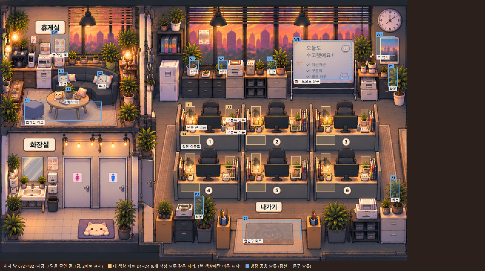
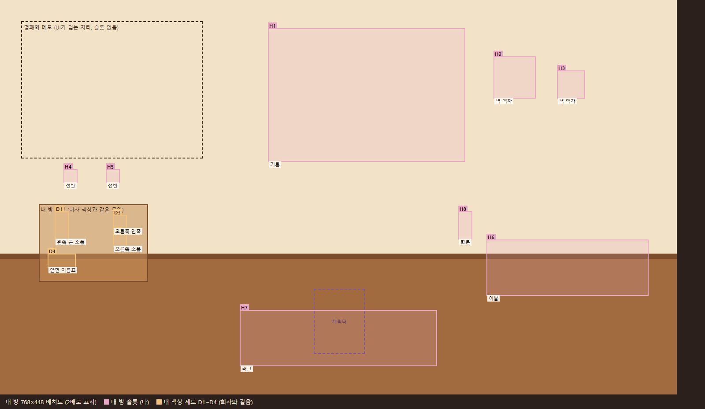

# 꾸미기 슬롯 계획: 회사 방과 내 방

2026-10-31 사용자 결정으로 정한 슬롯 계획이다. 새 도트 방 그림(회사 방 672×432, 내 방 768×448)이 이 자리를 비워 두고 그리도록 먼저 정해 둔다. 구현은 그림이 나온 뒤(빌드 순서 7단계)에 한다.

기준 문서: `design/game-brief.md`의 "꾸미기와 상점"과 "아트", `PRODUCT.md`(로비는 집), `AGENTS.md`(도트 규칙).

## 원칙

- 꾸미기는 슬롯 방식이다. 자유 배치는 하지 않는다 (브리프 범위 밖).
- 슬롯은 이름, 위치(1배 캔버스 px, 16px 격자), 크기, 그리는 층, 꾸미는 사람을 가진다.
- 아이템은 크기 등급을 가지고, 등급이 맞는 슬롯이면 어디에든 들어간다.
- 슬롯이 비어도 방 그림은 완성돼 보여야 한다 (빈 벽, 빈 선반, 맨 바닥). 기본으로 보일 소품은 무료 기본 아이템으로 둔다.
- 아이템 그림은 슬롯 크기의 투명 PNG, 1배, 바닥 가운데 기준이다.

## 1. 내 책상 세트 (나를 따라다님)

사용자 결정: 책상 꾸밈은 좌석이 아니라 사람에게 붙는다. 회사 방 좌석은 먼저 앉는 사람이 차지하므로, 내가 한 번 꾸민 세트가 내가 앉은 책상에 펼쳐진다. 친구가 앉으면 친구의 세트, 빈 자리는 기본 책상이다 (브리프의 "친구가 앉아 있으면 그 친구가 꾸민 책상이 보인다"와 같다). 내 방 책상에도 같은 세트가 놓인다.

| 슬롯 | 이름 | 크기 | 책상 칸막이 왼쪽 위 기준 위치 | 예 |
|---|---|---|---|---|
| D1 | 왼쪽 큰 소품 | 16×32 | (14, 4) | 스탠드, 화분, 책꽂이 |
| D2 | 오른쪽 소품 | 16×16 | (80, 28) | 머그, 피규어 |
| D3 | 오른쪽 안쪽 | 16×16 | (80, 8) | 책, 작은 화분 |
| D4 | 앞면 이름표 | 32×16 | (6, 52) | 이름표, 스티커 |

- 층: 책상 소품은 앉은 캐릭터의 하체를 가리는 책상 전경 층에 그린다. 모니터 앞 가운데는 비워 앉은 얼굴을 가리지 않는다.
- 좌석 번호는 책상 앞면 가운데에 남고, D4는 그 왼쪽이다.
- 같은 방 사람들에게는 꾸민 캐릭터 모습과 같은 방식으로 세트를 함께 보낸다.
- 가격: 책상 소품 180~600 코인 (브리프).

## 2. 회사 방 공용 슬롯 (방장)

좌표는 지금 회사 그림을 새 캔버스(672×432)로 줄인 밑그림 기준이라 대략이다. 새 그림이 나오면 맞춘다. 화장실에는 슬롯이 없다.

| 슬롯 | 이름 | 크기 | 위치 |
|---|---|---|---|
| C1, C2 | 휴게실 소파 쿠션 | 16×16 | (96, 120), (160, 124) |
| T1 | 휴게실 탁자 위 | 16×16 | (108, 150) |
| L1 | 휴게실 러그 | 128×32 | (40, 168) |
| LW | 휴게실 벽 | 32×32 | (84, 56) |
| W1 | 사무실 벽 액자 | 32×32 | (620, 60) |
| S1~S3 | 창 아래 캐비닛 위 선반 | 16×16 | (312, 100), (360, 100), (440, 100) |
| P1~P3 | 바닥 화분 | 16×32 | (640, 112), (644, 296), (320, 324) |
| E1 | 출입구 매트 | 96×32 | (400, 364) |
| WB | 화이트보드 문구 | 글 | (484, 68) 96×64 |

- WB는 아이템이 아니라 방장이 쓰는 무료 문구다 (지금 그림의 "오늘도 수고했어요!" 자리).
- 책상 6개의 칸막이 왼쪽 위: 위 줄 (292, 172), (400, 172), (515, 172), 아래 줄 (292, 250), (400, 250), (515, 250).
- 가격: 공용 가구 900~3000 코인 (브리프).

## 3. 내 방 슬롯 (나)

사용자 결정: 로비(집, 내 방)에도 꾸미기 자리를 둔다. 왼쪽 위(약 200×150)는 로비 명패와 메모가 덮어서 슬롯을 두지 않는다. 캐릭터는 러그 위, 발 기준 (384, 400) 근처에 선다.

| 슬롯 | 이름 | 크기 | 위치 |
|---|---|---|---|
| H1 | 커튼 | 224×152 | (304, 32) |
| H2 | 벽 액자 | 48×48 | (560, 64) |
| H3 | 벽 액자 | 32×32 | (632, 80) |
| H4, H5 | 벽 선반 | 16×16 | (72, 192), (120, 192) |
| H6 | 침대 이불 | 184×64 | (552, 272) |
| H7 | 러그 | 224×64 | (272, 352) |
| H8 | 화분 | 16×32 | (520, 240) |
| 책상 | 내 책상 세트 D1~D4 | 위 표 | 책상 칸막이 왼쪽 위 (48, 236) |

## 4. 그림 요구사항 (캐릭터 도트 세션)

1. 회사 방 672×432와 내 방 768×448 모두 위 슬롯 자리를 16px 격자에 맞춰 비워 두고 그린다.
2. 회사 책상 6개와 내 방 책상은 윗면 모양과 칸막이 기준 슬롯 위치(D1~D4)가 같아야 한다. 세트 하나가 어디에나 맞아야 한다.
3. 좌석 번호는 책상 앞면 가운데에 둔다.
4. 아이템 그림은 슬롯 크기의 투명 PNG, 1배, 바닥 가운데 기준으로 그린다.

## 5. 구현 순서 (그림 이후)

1. 슬롯 표를 설정 파일에 좌표 데이터로 둔다 (`companyFinalLayout.js`처럼). 화면은 방 그림 위에 슬롯 아이템 층을 1배로 얹는다.
2. 서버: 내 책상 세트(사람, 슬롯, 아이템), 회사 방 공용(방, 슬롯, 아이템, 방장만 바꿈), 내 방(사람, 슬롯, 아이템). 상점 아이템에 크기 등급을 더한다.
3. 꾸미는 곳: 꾸미기 화면에 "책상"과 "내 방" 탭, 회사 방 공용은 방장 도구.

## 아직 정하지 않은 것

- 내 방 아이템 가격대 (브리프에 없음).
- 처음 무료로 주는 기본 소품 수.
- 화이트보드 문구 길이.
