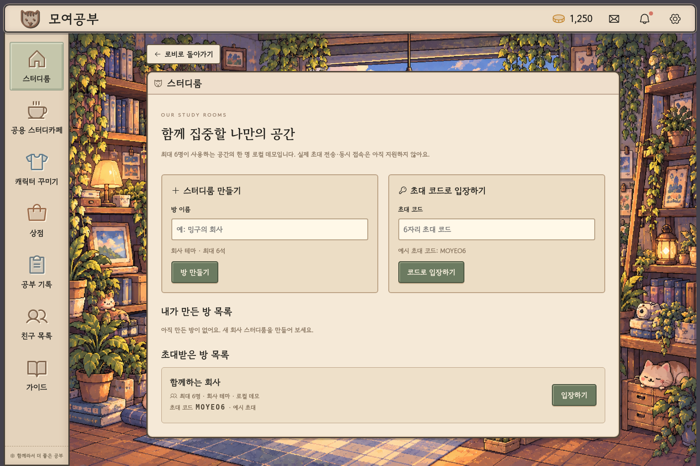
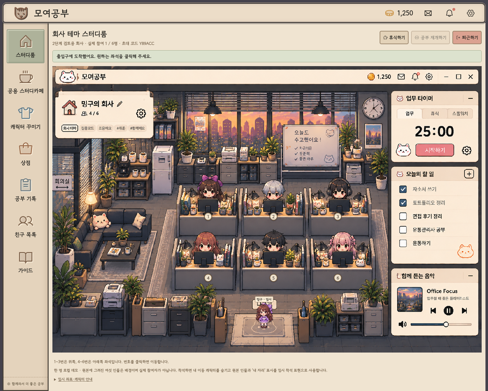
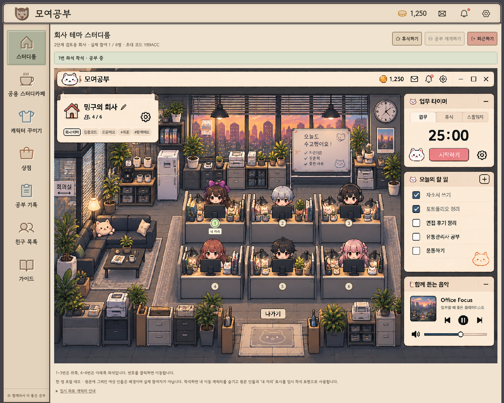
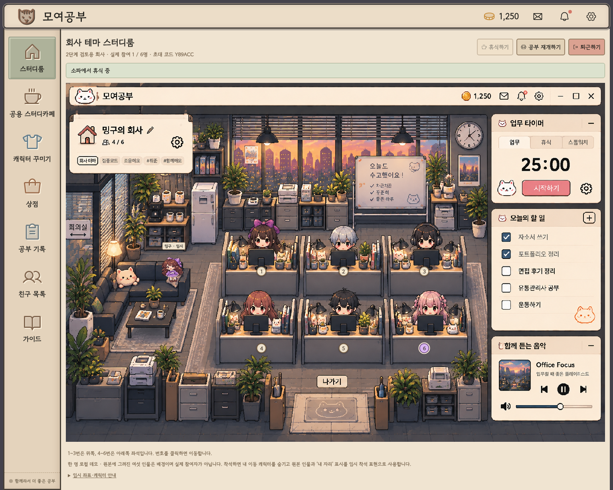

# 모여공부 2단계 브라우저 검토

검토일: 2026-10-16 (한국 시간). 대상: 현재 `work` 작업 내용. 도구: 실제 Chromium 헤드리스 브라우저 + Playwright. 이번 검토에서 앱·이동 좌표·원본·로비 디자인은 수정하지 않았고, 3단계 기능도 추가하지 않았습니다.

**판정: 기능 흐름 통과 / 화면 겹침 수정 필요.** 자동 테스트 통과는 원본의 모든 가구를 시각적으로 피한다는 뜻이 아닙니다.

## 요청한 네 화면

뷰포트는 1536×1024이며 페이지 전체를 촬영해 이미지 높이는 더 길 수 있습니다. 네 파일 모두 새로 캡처한 후 실제로 열어 상태를 확인했습니다.

1. **스터디룸 목록 — 정상.** 방 생성·내 방·예시 초대 방·코드 입장·로비 복귀가 구분됩니다.
   
2. **회사 입장 직후 — 기능 정상, 표시 중복 있음.** 출입구에 독립 캐릭터가 나타납니다. 원본 전체를 보존해 바깥 실제 헤더와 이미지 안 헤더가 함께 보입니다.
   
3. **1번 좌석 착석 — 상태 정상, 의도된 임시 표현.** 좌석 1번과 ‘내 자리’가 표시되고 독립 이동 캐릭터는 숨겨집니다. 배경의 기존 캐릭터가 임시 착석 표현이며 사용자 캐릭터로 교체된 것은 아닙니다.
   
4. **소파 휴식 — 이동·상태 정상, 자세 조정 필요.** 독립 캐릭터가 소파 오른쪽 쿠션/팔걸이 근처에 나타납니다. 축소·회전한 서 있는 이미지라 자연스러운 앉기 자세는 아닙니다.
   

## 실제 수행한 기능 검사

- 방 생성 및 회사 입장.
- 좌석 1 → 2 → 3 → 4 → 5 → 6 순서로 클릭, 각 이동 완료·선택·착석 확인.
- 6번에서 휴식 → 소파 도착 → 공부 재개 → 6번 복귀.
- 퇴근 → 출입구로 이동하는 상태 → 로비 복귀.
- 이동 중 좌석·휴식·퇴근 버튼 잠금(기존 테스트).
- 1280px·1536px에서 원본 3:2 비율, 좌석 6개와 소파의 상대 좌표 확인. 좌표 오차는 원본 비율 기준 0.001 미만으로 설정한 검사 허용 범위 안. 화면 크기 변경에 따른 누적 좌표 이탈은 발견하지 못했습니다.
- 기존 로비 메뉴·할 일·꾸미기·구매·닉네임, 방 저장·코드 검증 회귀 테스트.
- `npm run build`: 성공. `npm test`: 8개 통과 / 0 실패. 검토 스크립트: 모든 검사 통과, 브라우저 JavaScript 오류 0개.
- 기계 검사 결과: [stage2-review-results.json](stage2-review-results.json). 재현: 개발 서버 실행 후 프로젝트 루트에서 `node scripts/review-stage2.mjs`.

## 수정이 필요한 부분

### 우선 수정: 위쪽 통로가 냉장고와 겹침

출입구에서 위쪽 좌석으로 갈 때 x=0.256 부근의 상단 접근 경로가 원본의 냉장고 영역과 겹칩니다. 실제 캡처에서 캐릭터가 냉장고 표면 위로 표시됩니다. 그래프 위를 정확히 이동해도 경로 자체의 시각적 위치가 적절하지 않습니다.

다음 수정에서는 `src/study/companyLayout.js`의 위쪽 접근 노드를 원본과 대조해 재지정하고, 냉장고·수납장도 장애물 영역 검사에 포함해야 합니다. 원본에 분명한 통로가 없는 구간은 사용자와 이동 가능한 영역을 확정해야 합니다. 원본 수정은 해결책으로 사용하지 않습니다.

### 우선 수정: 중앙 경로에서 배경 인물과 겹침

위·아래 책상 사이의 y=0.602 경계에서 이동 캐릭터의 몸통이 아래쪽 배경 인물/책상 뒤쪽 위로 겹칩니다. 발 좌표와 책상 몸체 영역만 검사하는 현재 방식으로는 캐릭터 전체의 겹침을 막을 수 없습니다.

캐릭터 크기·몸통 영역을 포함한 충돌 기준과 별도의 앞뒤 가림 레이어가 필요합니다. 단일 배경 안에 가구와 인물이 합쳐져 있어 완전한 가림에는 원본을 보존한 별도 레이어 설계 합의가 필요합니다.

### 후속 조정: 소파 자세와 실제 사용자 착석 표현

소파 목적지와 발 기준점을 쿠션에 맞추고 정식 휴식/착석 스프라이트를 연결해야 합니다. 현재 착석 후 내 이미지가 사라지는 것은 사용자가 선택한 임시 방식으로, 작동 오류가 아닙니다. 배경에 그려진 다른 인물들도 실제 접속자 상태를 반영하지 않습니다.

### 표시·접근성 참고

원본 안의 타이머·음악·할 일·‘4/6’ 인원과 헤더는 이미지의 일부이며 클릭할 수 없습니다. 실제 버튼·참가 인원은 이미지 위 바깥 툴바에 있어 이중 표시가 혼동을 줄 수 있습니다(입장 화면). 실제 버튼을 더 명확히 구분하는 후속 설계가 필요합니다. 좌석 번호 클릭 영역은 DOM 확인상 25×25 CSS px로 작으며, 추후 투명 클릭 영역을 넓히는 방법을 검토할 수 있습니다. 스크린샷만으로 전체 접근성 준수나 보조기기 사용성을 검증하지 않았습니다.

## 보존 확인과 검토 한계

- 회사 원본 SHA-256: `90a5164adbf58f10004dabd4d00df436f08f8163e25ccc95ac843db0bc2e1c63` — Git의 기존 원본과 동일.
- 기존 로비 캐릭터 SHA-256: `d2e4b1b699648d813b6f6535e21b8eab921fa82c1c6b639df226c242ba32c381` — 변경 없음.
- 기존 `src/styles.css`와 원본 에셋은 2단계 전 기준 커밋과 차이 없음. 로비 메뉴에서 방 목록으로 가는 동작 변경은 2단계 요청 사항입니다.
- 고정 그래프와 책상 몸체의 보수적인 사각 영역을 통과하는지는 자동 검사했지만, 냉장고·배경 인물·스프라이트 몸통의 시각적 충돌은 그 검사의 대상이 아니었습니다. 이번 화면 검토로 그 한계를 확인했습니다.
- 로컬 Chromium 검사이며 외부 클라우드 브라우저·실제 멀티플레이·모든 해상도·모든 이동 순간의 완전한 충돌 검증은 아닙니다.
- 이번 요청은 검토와 현 상태 보관이므로 발견한 좌표 문제는 수정하지 않았습니다.
